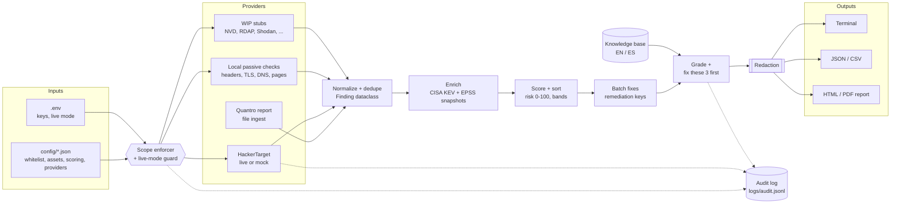

# WebScan

Vulnerability scanning and **prioritization** for nonprofits. A prototype built as an Angelo State
University cybersecurity capstone (Senior Design Project with Cyber Ready Clinic).

> **Prototype.** Runs entirely on mock data by default. See [docs/STATUS.md](docs/STATUS.md) for what is
> done, partial, and work in progress, and for the checklist to complete before any live scan.

## The problem

Standard scanners hand a small nonprofit a long, flat list sorted only by CVSS severity. A team with no
security staff cannot tell what to fix first, and stops reading.

WebScan takes scan results (HackerTarget, Quantro partner reports, and its own passive checks) and:

1. **Prioritizes** by real-world risk: severity × how exposed the system is × how important it is × whether
   attackers are already using the weakness (CISA KEV, EPSS).
2. **Batches** findings that one fix clears ("upgrade jQuery" clears seven findings on three systems).
3. **Explains** each finding in plain language, in English and Spanish, with fix steps for the platform the
   site runs on (WordPress, Wix, Squarespace, Google Sites, custom).

In the demo, a CVSS 6.1 jQuery flaw on the public donor portal ranks #2 (Critical) because it is on CISA's
known-exploited list, while a CVSS 9.8 flaw on a staging server ranks #18 (Medium).

## Authorization and confidentiality notice

- **Scan only what the organization has authorized.** Every target must be in `config/allowed_targets.json`.
  WebScan refuses to run if that file is missing, malformed, or empty.
- **Live queries are off by default.** A live call needs all of: the `--live` flag,
  `WEBSCAN_LIVE_MODE=true` in `.env`, and (for third-party services) the provider listed in
  `approved_providers` in `config/providers.json`. Otherwise every provider returns mock data.
- Private, loopback, link-local, multicast, and reserved addresses are **never** sent to an external
  provider, even if whitelisted.
- Real targets live only in `config/*.json`, which git ignores. Only `*.example.json` templates with
  placeholder data are committed. Output, logs, and `.env` are ignored too.
- Reports, console output, and logs are redacted by default (asset aliases instead of hostnames and IPs).
- No LICENSE file yet: license and repo visibility must be confirmed with the organization.

Details: [docs/SECURITY.md](docs/SECURITY.md).

## Quick start (demo, no network, no configuration)

```bash
python3 -m venv .venv
```

```bash
.venv/bin/pip install -e ".[dev]"
```

```bash
.venv/bin/webscan demo
```

```bash
.venv/bin/webscan demo --lang es
```

Output goes to `output/demo/`: `webscan_findings.json`, `webscan_findings.csv`, `webscan_batches.csv`,
`webscan_report_en.html`, `webscan_report_es.html`, and a PDF when a PDF engine is available.
(On Windows use `.venv\Scripts\` instead of `.venv/bin/`. Requires Python 3.11+.)

## Web UI

A local web interface for the scanner: add a domain, prove you own it, run a passive scan, read the results,
compare scans, and export reports. It reuses the same checks, scoring, and knowledge base as the CLI.

### Install and start

```bash
python3 -m venv .venv
```

```bash
.venv/bin/pip install -e ".[web,dev]"
```

```bash
cp .env.example .env
```

```bash
.venv/bin/webscan web
```

Then open <http://127.0.0.1:5500>. One command starts both servers; stop them with Ctrl+C.

| What | Address | Notes |
|---|---|---|
| UI (static files) | `http://127.0.0.1:5500` | Strict Content Security Policy, no inline scripts or styles. |
| API | `http://127.0.0.1:8000/api` | CORS allows only the UI origin. Every route is under `/api`. |

Both bind to `127.0.0.1` only. Hosts, ports, and limits are read from `.env` (`WEBSCAN_UI_*`, `WEBSCAN_API_*`,
and the throttling values; see `.env.example`). A non-loopback host such as `0.0.0.0` is refused at startup.

**Try Demo** on the start page works straight away: it replays the bundled mock data for the fictional
`demo.example.com`, with a simulated progress run, and sends no requests to any website.

**Real scans are off until you turn them on.** Set `WEBSCAN_LIVE_MODE=true` in `.env` and restart. This is the
same master switch the CLI uses. Without it the server refuses to verify domains or start scans.

### Scanning your own site

1. **Domains → Add domain.** Enter the hostname (for example `www.example.org`). Each hostname is verified
   separately.
2. **Verify ownership** with either method, then press **Check Verification**:
   - DNS: add a TXT record on the domain with the value `scanner-verify=<token>`.
   - File: serve the token at `https://<domain>/.well-known/scanner-verify.txt`.
3. **Scan → Start Scan.** Tick the authorization box (asked once, timestamp recorded), choose Quick or Full.
4. Read the results, export PDF or JSON, and use **History** to compare two scans of the same domain.

`localhost` and `127.0.0.1` (with an optional port, for example `localhost:3000`) can be scanned without
verification, for testing an app running on this computer.

### Guardrails (enforced by the API, not only by the page)

| Rule | How |
|---|---|
| Ownership verification | Random per-domain token; DNS TXT or `/.well-known/` file; expires after `WEBSCAN_VERIFICATION_TTL_DAYS` (30). Unverified or expired domains get HTTP 403. |
| Authorization acknowledgment | Required before the first scan; timestamp stored and written to the audit log. |
| Scope | Only the verified host is contacted. Redirects and links to other hosts are never followed. |
| SSRF protection | The hostname is resolved, every address is checked (private, loopback, link-local, cloud metadata, CGNAT, reserved are blocked), and the connection is pinned to the checked address. IP literals are not accepted as targets. |
| Non-destructive | Only the existing passive checks run: GET requests, a TLS handshake, DNS lookups. No payloads, logins, form posts, or load testing. |
| Rate limiting | `WEBSCAN_MAX_REQUESTS_PER_SECOND` per target (2, hard cap 5), `WEBSCAN_MAX_CONCURRENT_SCANS` (2), `WEBSCAN_SCAN_COOLDOWN_SECONDS` between scans of one domain (60), overall `WEBSCAN_SCAN_TIMEOUT_SECONDS` (180). |
| Identification | Every request sends `User-Agent: WebScan/0.1 (authorized nonprofit security assessment)`. |
| Cancel | Stops the scan at once and closes any request in flight. |
| Audit log | The **Audit log** page lists each scan with domain, time, verification method, and result summary. Request-level detail also goes to `logs/audit.jsonl`. |

Quick scan runs the header, TLS, and cookie checks. Full scan adds SPF/DMARC/DKIM, trackers and privacy
policy, and the short exposed-files list. The donation-page check needs per-asset configuration and stays
CLI only.

Web UI data (domains, scans, audit log) is stored in `output/web/webscan_ui.sqlite`, which git ignores.
PDF export uses the same engines as the CLI report (WeasyPrint, Playwright, or a local Chrome/Edge); without
one, use **Printable report** and print to PDF from the browser.

## Architecture



More in [docs/ARCHITECTURE.md](docs/ARCHITECTURE.md).

## Configuration

Copy each template in `config/` and remove `.example` from the name. The copies are ignored by git.

| File | Required | Purpose |
|---|---|---|
| `config/allowed_targets.json` | **yes** | The approved asset inventory (whitelist): `domains`, `ips`, `cidrs`, and a `local_only` section for internal assets. No file, no scan. |
| `config/assets_metadata.json` | **yes** | Maps each asset to an alias, hostnames/IPs, `exposure_tier` (public / internal / staging), `asset_criticality` (1–3), description, platform, optional `donation_paths` and `email_domain`. |
| `config/scoring.json` | no | Multipliers, EPSS threshold, priority bands, grade settings. Built-in defaults are used when absent. |
| `config/providers.json` | no | `approved_providers`, `enabled_providers`, HackerTarget rate limits and quota, local check settings, Quantro field mapping. Defaults approve nothing. |

Environment variables (`.env`, see `.env.example`):

| Variable | Default | Purpose |
|---|---|---|
| `WEBSCAN_LIVE_MODE` | `false` | Master switch for live network calls. |
| `HACKERTARGET_API_KEY` | empty | Sent as the `apikey` query parameter. Without it HackerTarget stays on mock data. |
| `WEBSCAN_CONFIG_DIR` / `WEBSCAN_OUTPUT_DIR` / `WEBSCAN_LOG_DIR` | `config` / `output` / `logs` | Paths. |
| `NVD_API_KEY`, `HIBP_API_KEY`, `SHODAN_API_KEY`, `GOOGLE_SAFE_BROWSING_API_KEY`, `VIRUSTOTAL_API_KEY` | empty | Keys for WIP providers. |
| `GEOIP_DB_PATH` | `data/reference/GeoLite2-City.mmdb` | Local MaxMind database for the GeoIP stub. |
| `LOCAL_LLM_URL`, `LOCAL_LLM_MODEL` | `http://localhost:11434`, `llama3.1` | Local model only; non-localhost URLs are refused. |
| `WEBSCAN_DASHBOARD_TOKENS` | empty | `token:role` pairs for the optional dashboard. |
| `WEBSCAN_UI_HOST` / `WEBSCAN_UI_PORT` / `WEBSCAN_API_HOST` / `WEBSCAN_API_PORT` | `127.0.0.1` / `5500` / `127.0.0.1` / `8000` | Web UI and API addresses. Loopback only. |

## Usage

Every command accepts `--operator <name>` (recorded in the audit log). Commands that read config accept
`--config-dir <dir>` and `--example-config` (use the committed placeholder configs).

| Command | What it does |
|---|---|
| `webscan validate` | Checks every config file, the whitelist, and that each asset's targets are whitelisted. |
| `webscan scope-check <target>` | Shows whether a target is in scope, whether it may go to an external provider, and why. Exit code 2 if out of scope. |
| `webscan scan --asset <alias> [--live]` | Runs enabled providers against one asset. |
| `webscan scan --all [--live]` | Runs against every asset in the inventory. `--include-wip` adds the WIP stubs (mock data). |
| `webscan ingest-quantro <report_file>` | Ingests a Quantro report using the field mapping in `providers.json`. |
| `webscan prioritize` | Scores, sorts, and batches all current findings; prints the summary. `--input <file>` scores findings from a JSON file. |
| `webscan report [--lang en\|es] [--format terminal\|json\|csv\|html\|pdf]` | Produces a report from current findings. |
| `webscan demo [--lang en\|es]` | Full pipeline on mock data, no network. `--include-wip`, `--no-pdf`. |
| `webscan refresh-reference-data` | Downloads the public CISA KEV and EPSS files (sends no target data). |
| `webscan changes` | Later phase: what changed since the previous run. |
| `webscan dashboard` | Later phase: local read-only dashboard (`pip install -e ".[dashboard]"`). |
| `webscan web` | Local web UI on `http://127.0.0.1:5500` (`pip install -e ".[web]"`). See [Web UI](#web-ui). |

`--no-redact` (on `scan`, `ingest-quantro`, `prioritize`, `report`, `demo`) writes unredacted output to
`output/unredacted/`, prints a warning, and is recorded in the audit log.

Typical flow with real configuration:

```bash
.venv/bin/webscan validate
```

```bash
.venv/bin/webscan scan --all
```

```bash
.venv/bin/webscan ingest-quantro path/to/quantro_report.json
```

```bash
.venv/bin/webscan report --format html --lang es
```

Try the same flow on placeholder data by adding `--example-config` to each command.

## How the score works

```
Risk Score = CVSS Base × Exposure Multiplier × Asset Criticality Weight × Exploit Availability Factor
```

| Factor | Default values |
|---|---|
| Exposure | public 1.5, staging 1.0, internal 0.8 |
| Criticality | 1 → 1.0, 2 → 1.5, 3 → 2.0 |
| Exploit | CISA KEV or known public exploit 1.5; EPSS ≥ 0.10 → 1.3; otherwise 1.0 |

The product is divided by the largest possible product (45 with the defaults) and scaled to 0–100.
Bands: Critical ≥ 60, High ≥ 40, Medium ≥ 20, Low ≥ 5, Info below that. Anything in CISA KEV or with a
known exploit is never ranked below High. Every finding stores the full calculation, shown under
"Technical details" in the report.

## Features

| Feature | Status |
|---|---|
| Scope enforcer, fail-safe whitelist, injection rejection | ✅ |
| Risk scoring, KEV/EPSS enrichment, exploitability override | ✅ |
| Remediation batching, grade, "fix these 3 first" | ✅ |
| Terminal summary, JSON/CSV export, HTML/PDF report | ✅ |
| Plain-language EN/ES knowledge base, platform-aware fixes, CIS IG1 + NIST CSF mapping | ✅ (needs human review) |
| Redaction, audit log | ✅ |
| HackerTarget client (rate limit, quota, backoff) | 🟡 tested with mocks only, never run live |
| Local passive checks | 🟡 tested on fixtures only |
| Quantro ingestion | 🚧 assumed schema |
| HackerTarget OpenVAS / Nikto | 🚧 mock only |
| NVD, RDAP, GeoIP, HIBP, Shodan, reputation, lookalike domains, local LLM | 🚧 stubs with mock data |
| Dashboard, change detection | 🟡 partial |
| Web UI with ownership verification, demo mode, history, compare, PDF/JSON export | 🟡 real scans tested against fake transport and localhost only |
| RBAC beyond tokens, scheduled rescans, clinic mode | 🚧 not started |

Full detail, with what is missing for each: [docs/STATUS.md](docs/STATUS.md).

## Development

```bash
.venv/bin/pytest
```

```bash
.venv/bin/ruff check .
```

Tests run with no network access: a fixture fails any test that opens a socket.

## Documentation

- [docs/STATUS.md](docs/STATUS.md): pre-live checklist and feature status
- [docs/ARCHITECTURE.md](docs/ARCHITECTURE.md): components, data flow, how to add a provider
- [docs/SECURITY.md](docs/SECURITY.md): authorization, confidentiality, and data handling rules
- [docs/DECISIONS.md](docs/DECISIONS.md): design decisions made during the build
- [docs/ROADMAP.md](docs/ROADMAP.md): phases, risks, team placeholders
- [docs/providers/](docs/providers/): one page per provider
