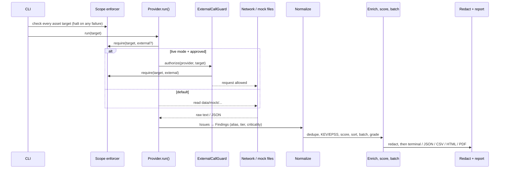

# Architecture

## Components

| Path (under `src/webscan/`) | Responsibility |
|---|---|
| `cli.py` | Typer commands. Builds a `RunContext`, calls the pipeline, prints or writes results. |
| `config.py` | Loads `.env` and `config/*.json`, validates them, holds the `AssetRegistry`. |
| `context.py` | `RunContext`: settings, scope enforcer, assets, redactor, audit logger, guard. Built once per command. |
| `models.py` | `Finding` (the data contract), `Issue` (parser output before asset context), `Batch`. |
| `scope/enforcer.py` | The only place that decides whether a target may be touched. |
| `providers/guard.py` | `ExternalCallGuard`: live-mode, provider-approval, and scope gate called right before any network request. |
| `providers/base.py` | `Provider` interface. `run()` is final and does the scope check and audit logging. |
| `providers/registry.py` | The list of providers. |
| `providers/hackertarget/` | `endpoints.py` (definitions), `client.py` (HTTP, rate limit, quota, backoff), `parser.py` (raw text → issues), `provider.py`. |
| `providers/quantro/` | Field-mapping-driven report parser and file-ingest provider. |
| `providers/local/` | Passive checks (`checks.py`), fixture and live fetchers (`fetch.py`), shared header analysis. |
| `providers/stubs/` | WIP third-party providers, mock by default. |
| `ingest/normalize.py` | `Issue` → `Finding` (asset alias, tier, criticality, knowledge match) and cross-source dedup. |
| `enrichment/reference.py` | CISA KEV and EPSS from local snapshots; the refresh function. |
| `enrichment/platform.py` | Platform detection from headers and HTML. |
| `scoring/engine.py` | Risk score, bands, override, sort, per-finding breakdown. |
| `batching/engine.py` | Remediation batches ranked by total risk removed. |
| `summary.py` | Grade, "fix these 3 first", executive paragraph. |
| `knowledge/` | `catalog.json` (matching rules, remediation keys, frameworks), `en.json` / `es.json` (text), `frameworks.json`. |
| `reporting/` | `terminal.py` (rich), `export.py` (JSON/CSV), `html_report.py` + Jinja2 template (HTML/PDF). |
| `sanitize/redact.py` | One `Redactor` used by console, files, logs. |
| `audit/logger.py` | Append-only JSON Lines audit log. |
| `store.py`, `history.py` | Local state between commands; SQLite run history and change detection. |
| `dashboard/` | Optional read-only FastAPI dashboard. |

## Data flow



1. **Collect.** `pipeline.collect` scope-checks every target of every selected asset first; one failure
   halts the whole scan. It then calls `provider.run(target)` for each provider. Internal-only targets are
   skipped for external providers (and `run()` would reject them anyway).
2. **Parse.** Provider parsers are pure functions: raw text in, `Issue` objects out. A malformed line or
   record is skipped with a redacted warning.
3. **Normalize.** `build_finding` attaches the asset alias, exposure tier, criticality, and platform from
   `assets_metadata.json`, matches a knowledge-base entry (explicit id → CVE → keyword), fills the
   remediation key and framework mappings, and redacts evidence. Unknown assets get conservative defaults
   and a warning.
4. **Dedupe.** Findings with the same asset and CVE (or the same asset and knowledge id / normalized name)
   merge. `sources` lists everyone who reported it; the highest severity wins.
5. **Enrich.** KEV membership and EPSS score come from `data/reference/`.
6. **Score and sort.** See below.
7. **Batch and summarize.**
8. **Report.** Everything dynamic passes through the redactor.

## Scoring formula

```
raw        = CVSS × exposure_multiplier × criticality_weight × exploit_factor
risk_score = raw / max_possible_raw × 100          (max is 45 with default config)
```

- `exploit_factor`: 1.5 if in CISA KEV or a known exploit exists; else 1.3 if EPSS ≥ threshold; else 1.0.
  Factors do not stack.
- Bands (minimum score): Critical 60, High 40, Medium 20, Low 5, Info 0.
- **Override:** a KEV or known-exploit finding below High is raised to High and its score is floored at
  the High threshold, so the sort order agrees with the label.
- **Sort:** risk score, then EPSS, then CVSS, all descending.
- **Explainability:** `finding.score_breakdown` stores each factor, the raw and normalized scores, whether
  the override applied, and a one-line formula.

All numbers live in `config/scoring.json`.

### Grade

`grade_score = max(0, 100 − Σ penalty[priority])` with default penalties Critical 15, High 5, Medium 1.5,
Low 0.25, Info 0. A ≥ 90, B ≥ 80, C ≥ 70, D ≥ 60, else F. Any Critical finding caps the grade at D.

### Batches

Key = `remediation_key`, or `fix:<normalized name>` when none is known. Ranked by the sum of member risk
scores. The "fix these 3 first" list takes batches in that order but puts batches containing a Critical or
High finding ahead of batches made only of lower-priority items (see DECISIONS.md, D-12).

## The gates that protect live calls

A live request is possible only when all of these pass, in code that providers cannot bypass:

1. `Provider.run()` (final; subclasses that override it raise `TypeError` at import) calls
   `scope.require(target, external=provider.is_external)`.
2. The HTTP layer calls `ExternalCallGuard.authorize()` immediately before the request. It requires: not
   demo mode, `--live`, `WEBSCAN_LIVE_MODE=true`, the provider in `approved_providers` (third parties) or
   `enabled_providers` (local checks), and a second scope check.
3. The scope enforcer refuses private, loopback, link-local, multicast, and reserved addresses, and
   internal hostname suffixes, for any external provider.

## How to add a provider

1. Create `providers/<name>/` (or `providers/stubs/<name>.py` for a WIP one).
2. Write a parser that turns raw output into `Issue` objects. Keep it pure and tolerant of bad input.
3. Subclass `Provider` (or `StubProvider`), set `name` and `is_external`, and implement
   `_collect(target, decision, live)`. Do **not** override `run()`. Return
   `build_findings(ctx, target, issues, name, "live" | "mock")`.
4. Any live request must call `ctx.guard.authorize(name, target, third_party=is_external)` first
   (`StubProvider.guarded_get` does this for you).
5. Add mock data under `data/mock/`, register the class in `providers/registry.py` (stubs:
   `providers/stubs/__init__.py`), document it in `docs/providers/<name>.md`, add env vars to
   `.env.example`, and add a row to `docs/STATUS.md`.
6. If the provider reports new kinds of findings, add entries to `knowledge/catalog.json`, `en.json`, and
   `es.json`. A test checks the three stay in sync.

## State and files

| Location | Contents | In git |
|---|---|---|
| `output/state/findings_raw.json` | Normalized findings from `scan` / `ingest-quantro` | no |
| `output/state/history.sqlite` | Run history for change detection | no |
| `output/state/hackertarget_quota.json` | Daily request counter | no |
| `output/`, `output/demo/`, `output/unredacted/` | Reports and exports | no |
| `logs/audit.jsonl`, `logs/webscan.log` | Audit log and diagnostics (both redacted) | no |
| `data/mock/`, `data/reference/*_snapshot.*` | Mock payloads and bundled reference subsets | yes |
